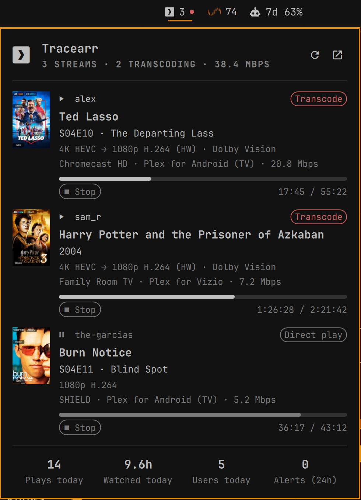

# Tracearr for Omarchy



An [Omarchy](https://omarchy.org/) bar widget for [Tracearr](https://github.com/connorgallopo/Tracearr): see who is watching what on your Plex, Jellyfin or Emby server without opening a browser.

- **Bar:** active stream count, with a red dot while anything is transcoding. Hover for a one-line-per-stream summary.
- **Popup:** a card per stream with poster, user, title/episode, play/pause state, Direct play / Direct stream / Transcode badge, quality (`4K HEVC → 1080p H.264 (HW) · Dolby Vision`), player and bitrate, and a live progress bar. Below that are today's plays, hours watched, active users and alerts in the last 24h.
- **Stop stream:** two-click Stop button per stream (click once to arm, again within 4s to confirm), with a custom message shown to the viewer.

## Install

```bash
omarchy plugin add https://github.com/jmb11111/omarchy-tracearr.git --enable
```

Then set your server and key:

```bash
omarchy bar set jmb11111.tracearr url https://tracearr.example.com
omarchy bar set jmb11111.tracearr apiKey trr_pub_xxxxxxxx
```

Generate the key in Tracearr under **Settings → General** (it starts with `trr_pub_`).

> The URL must reach Tracearr's API directly. If Tracearr sits behind a forward-auth proxy (Authentik, Authelia, etc.), the widget can't log in. Use a route without forward auth, or exempt `/api/v1/public` from it. Tracearr still checks the API key.

## Settings

All settings live on the widget's entry in `~/.config/omarchy/shell.json`.

| Key | Default | |
|---|---|---|
| `url` | `""` | Tracearr base URL |
| `apiKey` | `""` | Public API key (`trr_pub_…`) |
| `pollSeconds` | `15` | Refresh interval (5–3600) |
| `hideWhenIdle` | `false` | Hide the widget when nothing is playing |
| `showPosters` | `true` | Poster art in the popup |
| `allowStop` | `true` | Show the Stop button on each stream |
| `stopMessage` | `"This stream was stopped by the server admin."` | Message the viewer sees when stopped |

## Controls

| Action | |
|---|---|
| Left-click | Open/close popup |
| Middle-click | Refresh now |
| `r` (popup) | Refresh |
| `o` (popup) | Open Tracearr in the browser |

IPC: `omarchy-shell tracearr <open|close|toggle|refresh|count|status>`. Use `status` to print the last fetch result or error.

## How it works

The widget polls `GET /api/v1/public/streams` and `GET /api/v1/public/stats/today` with `curl`. Stop sends `POST /api/v1/public/streams/{id}/terminate`. The API key is piped to curl on stdin, so it never appears in the process list. Posters load through Tracearr's image proxy. Nothing is stored outside `shell.json`.

Requires `curl`.

## License

MIT
